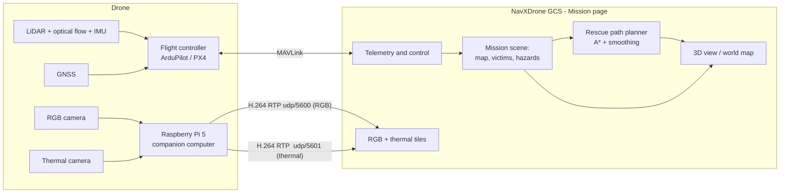

# NavXDrone GCS — Smart India Hackathon 2026

**Problem statement:** SIH26177 — autonomous search-and-rescue drone
**Team:** Asunama

NavXDrone is our ground control station (GCS) for a search-and-rescue drone that works both **inside damaged buildings with no GPS** and **over open disaster areas with GPS**. It is built on [Mission Planner](https://github.com/ArduPilot/MissionPlanner), the open-source ArduPilot GCS, with a dedicated **Mission** page for rescue operations.

On one screen the rescue team sees:

- where the drone is and what it has already searched,
- every **victim** and **hazard** it has found, with a location tag,
- the **safest walking route** from the team to each victim,
- the drone's **return-to-home (RTL)** path,
- live **RGB and thermal** camera feeds.

---

## Contents

1. [Quick start: run the demo](#1-quick-start-run-the-demo)
2. [The two navigation modes](#2-the-two-navigation-modes)
3. [Features](#3-features)
4. [System architecture](#4-system-architecture)
5. [Connecting real hardware](#5-connecting-real-hardware)
6. [Building from source](#6-building-from-source)
7. [Code map](#7-code-map)
8. [Current status and limitations](#8-current-status-and-limitations)

---

## 1. Quick start: run the demo

The Mission page has a built-in **Demo Mode**. It runs a full, scripted rescue mission with no drone, radio or camera connected, so the whole workflow can be shown on any Windows laptop.

1. Launch `MissionPlanner.exe` (see [Building from source](#6-building-from-source), or use the release download in the main [README](README.md)).
2. Click **Mission** in the top menu bar.
3. Click **Demo Mode**. A finished indoor search appears straight away: the full map, every victim and hazard, and the best rescue route.
4. Choose a scenario:
   - **Indoor (default):** press **Start Mission** to watch the drone search a building room by room with no GPS.
   - **Outdoor:** click **World Map**, then **Start Mission** to watch a GPS lawnmower survey of an open area.
5. Click **Abort / E-Stop** at any time during a flight to send the drone home.
6. Click **Demo Mode** again to leave the demo and go back to live data.

> Demo Mode only changes what the screen shows. It never sends a command to a real vehicle.

### What happens in each demo

| | Indoor search (GPS-denied) | Outdoor survey (GPS-enabled) |
|---|---|---|
| View | 3D view of the building | Real world map |
| Site | 15 × 15 m building: rooms, corridor, entry and exit | 150 × 150 m disaster area with three collapsed buildings |
| Flight | Room-by-room route at 1.6 m height | Lawnmower pattern at 30 m: 9 parallel lanes, 16.8 m apart |
| Navigation | LiDAR SLAM + optical flow + IMU | GNSS (3D fix) |
| Location tags | Grid box, e.g. `Grid F3` | Latitude/longitude, e.g. `GPS 12.97241, 77.59488` |
| Finds | 5 survivors, 4 hazards | 6 victims, 4 hazards |
| Extra | Low-battery return to the dock, recharge, then resume the search | RTL to base once the survey is complete |
| Duration | About 3 minutes | About 2 min 40 s |

---

## 2. The two navigation modes

A real disaster site has both: collapsed buildings where GPS does not reach, and open ground around them where it does. The GCS supports both and labels every detection accordingly.

### GPS-denied mode (indoor)
- The drone navigates on **LiDAR SLAM, optical flow and the IMU**.
- The centre pane shows a **3D view**: explored floor, mapped walls, the drone and its trail, victims and hazards.
- Detections are tagged with a **grid box** (columns A–Z, rows 1…), which a rescue team can use inside a building.

### GPS-enabled mode (outdoor)
- With a GPS fix, the centre pane switches to a **world map**. It uses OpenStreetMap tiles when there is internet; without internet the markers and routes are still drawn in the right places, over a plain background.
- Detections are tagged with **real latitude/longitude**.
- The drone surveys the area in a **lawnmower (boustrophedon) pattern**: parallel back-and-forth lanes, spaced slightly narrower than the camera's footprint so that no strip of ground is missed.

With a live vehicle, the page switches modes **automatically** from the flight controller's GPS fix. In Demo Mode, the **World Map / Indoor View** button chooses the scenario.

---

## 3. Features

### Search coverage
- **Lawnmower survey pattern** for open areas. The map shows the planned lanes as dotted lines, and a shaded band fills in behind the drone as it covers ground.
- **Room-by-room search** indoors. The map builds up as the drone sees floor and walls, the same way a live SLAM map would.
- **Coverage percentage** is shown live.

### Victim and hazard tagging
- **Victims** are tagged the moment they come into the camera's view. Outdoors, the drone hovers for 2 s over each new victim to confirm it before moving on.
- **Hazards** come in four classes, each with a priority from Low to Critical:

  | Hazard | Example |
  |---|---|
  | Fire | Active fire or smoke |
  | Flood | Standing or flowing water |
  | Electrical | Exposed wiring, downed power line |
  | Structural | Collapse risk |

- Each hazard gets a **keep-out zone**: 1.4 m radius indoors, 8 m outdoors. It is drawn on the map, and rescue routes stay out of it.
- Every find is written to the **event log** with its time and location tag.

### Best rescue path
- For each victim, the GCS plans the **shortest safe walking route** for the ground team. Indoors it starts at the building entry; outdoors, at the rescue staging point.
- The route:
  - only crosses ground the drone has **actually surveyed**, never unknown space,
  - keeps a body-width away from walls and building outlines,
  - goes around every hazard's keep-out zone,
  - is simplified into a few straight legs a person can walk.
- Routes are **re-planned automatically** whenever a new hazard or wall is found.
- The newest victim's route is highlighted without the operator clicking anything. Clicking any victim shows that victim's route and its length in metres.
- How it works: an A\* search on a grid over the surveyed area (8-directional, no cutting across wall corners), then line-of-sight smoothing into straight legs. See `Controls/Dashboard/RescuePathPlanner.cs`.

### Return to home (RTL)
- While the drone is flying, the map shows a dashed **"RTL path if recalled now"** line and its distance.
- During an actual return (Abort, end of survey, or low-battery docking), the line turns **solid orange** and is labelled **RTL ACTIVE**.
- **Abort / E-Stop** on a live vehicle switches the flight controller to **RTL mode**. It deliberately does not disarm, so the drone is never dropped mid-air.

### Mission continuity and auto-charging
- On low battery during an indoor search, the drone:
  1. flies back to the docking station over the mapped area,
  2. lands and recharges,
  3. takes off and **resumes the search from the exact point where it stopped**.

### Live video and telemetry
- **Two video tiles, RGB and thermal**, fed over RTP/UDP from the onboard computer.
- A **status strip** along the bottom: navigation source and GPS state, flight mode, mission clock, victims found, area explored, arming state and battery.
- A **Telem Log** drawer, opened on request: detailed telemetry, link health (quality, bandwidth, latency), the event log, and **PX4 ULog replay**.

---

## 4. System architecture



| Part | Role |
|---|---|
| Flight controller | Stabilisation, navigation (LiDAR / optical flow in GPS-denied mode, GNSS outdoors), failsafes and RTL |
| Raspberry Pi 5 | Captures RGB and thermal video and streams both to the GCS; will host the onboard victim/hazard detection model |
| GCS Mission page | Shows everything above on one screen, plans rescue routes, and sends start / RTL commands |

---

## 5. Connecting real hardware

### Flight controller
1. Connect the telemetry radio or USB.
2. On the Mission page, click **Connect**. It uses Mission Planner's normal port and baud selection.
3. **Start Mission** arms the vehicle and switches it to **AUTO**. **Abort / E-Stop** switches it to **RTL**.

The drone's position comes from the vehicle's local position estimate (`LOCAL_POSITION_NED`). This is available with or without GPS. Once the vehicle reports a 3D GPS fix and a home position, the page switches to the world map and starts tagging detections with latitude/longitude.

### Cameras (RGB + thermal)
Run the companion script on the Raspberry Pi:

```bash
sudo apt install gstreamer1.0-tools
pip install opencv-python numpy

python3 companion/rgb_thermal_stream.py --host <GCS-laptop-IP> \
        --rgb-device 0 --thermal-device 1
```

- By default the RGB feed goes to **UDP 5600** and the thermal feed to **UDP 5601**. These match the GCS defaults, so no GCS setup is needed.
- Most small thermal modules (FLIR Lepton on PureThermal, Seek Thermal) appear as an ordinary webcam. If yours outputs raw greyscale, add `--thermal-raw`; the script then colours it (`--colormap`, default `inferno`).
- If a camera does not work with the Pi's hardware encoder, use `--encoder x264enc`.
- Run `python3 companion/rgb_thermal_stream.py --help` for all options.

The **GCS laptop needs GStreamer** installed to decode the video. To use different ports or pipelines, change the settings `mission_rgb_pipeline` and `mission_thermal_pipeline`.

---

## 6. Building from source

**Requirements:** Windows 10/11, **Visual Studio 2022**. Use the installer's *Import configuration* with the upstream [vs2022.vsconfig](https://raw.githubusercontent.com/ArduPilot/MissionPlanner/master/vs2022.vsconfig) to get the right components.

```powershell
git clone https://github.com/dhakshanl/dmp.git
cd dmp
# Open MissionPlanner.sln in Visual Studio and build (Debug), or from a Developer prompt:
msbuild MissionPlanner.csproj /p:Configuration=Debug
```

The output is `bin\Debug\net461\MissionPlanner.exe`.

> Close any running copy of the app before building, or the build fails on locked files.

---

## 7. Code map

Everything for SIH 2026 lives on the Mission page and its dashboard controls:

| File | What it does |
|---|---|
| `GCSViews/Mission.cs` | The Mission page: live telemetry, Demo Mode, GPS / GPS-denied switching, RTL path, start/abort commands, ULog replay |
| `Controls/Dashboard/MissionScene.cs` | Shared data model: site, walls, explored area, victims, hazards, GPS anchor (local metres → lat/lon), RTL path, survey pattern |
| `Controls/Dashboard/MissionSceneView.cs` | 3D indoor view (GPS-denied mode) |
| `Controls/Dashboard/MissionWorldMapView.cs` | World map (GPS-enabled mode): survey area and lanes, coverage band, keep-out zones, rescue route, RTL path, info chips |
| `Controls/Dashboard/RescuePathPlanner.cs` | Best-path planner: A\* on a grid plus smoothing into straight legs |
| `Controls/Dashboard/MissionDemoSimulator.cs` | Demo Mode: indoor room-by-room search and outdoor lawnmower survey, detection, docking and recharge, RTL |
| `Controls/Dashboard/SurvivorListView.cs` | Victim and hazard list on the left |
| `Controls/Dashboard/MissionStatusBar.cs` | Bottom status strip |
| `Controls/Dashboard/VideoFeedPanel.cs` | GStreamer video tiles |
| `companion/rgb_thermal_stream.py` | Raspberry Pi script that streams RGB and thermal video to the GCS |

---

## 8. Current status and limitations

| Area | Status |
|---|---|
| Mission page UI, both modes, path planning, RTL display | ✅ Working |
| Demo Mode: indoor search and outdoor lawnmower survey | ✅ Working (simulated data) |
| Live telemetry, drone position, GPS switching, Start / RTL commands | ✅ Working with a real flight controller |
| RGB + thermal streaming from the Pi | ✅ Script ready; confirm with the actual cameras before the demo |
| **Onboard victim/hazard detection → GCS** | 🚧 **Not yet connected.** With a live vehicle, victims and hazards will appear once the companion computer's detection model sends them. Until then, detections come only from Demo Mode. |
| Live SLAM map (walls / explored floor) → GCS | 🚧 Planned. The live view currently shows the drone's position and trail. |
| Lawnmower survey as a real flight-controller mission | 🚧 Planned. Uploading the pattern as waypoints is the next step; the demo shows the intended behaviour. |

---

*Built on ArduPilot Mission Planner (GPLv3). See [LICENSE.md](LICENSE.md) and the main [README](README.md) for upstream documentation.*
